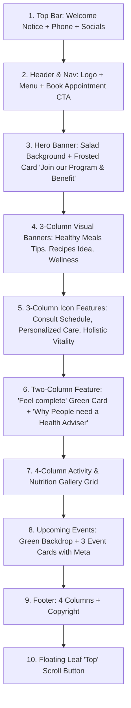

# MD Nutrition Centre - WordPress UI Architecture & Implementation Guide

This guide breaks down the exact UI structure from the reference design (**Aarogya / Health Coach**) and explains how to build it in WordPress using either:
1. **The Custom WordPress Theme** (included in `md-nutrition-theme.zip`)
2. **Elementor Page Builder** (step-by-step container & widget mapping)
3. **WordPress Gutenberg Block Editor**

---

## 1. Design System & Brand Identity

### Color Palette
| Color Role | Hex Code | Purpose |
| :--- | :--- | :--- |
| **Primary Herb Green** | `#609432` / `#5b8e34` | Top bar, logo accents, subheadings, primary CTA, leaf icon |
| **Dark Forest Green** | `#4e7a27` | Button hover states, text headings |
| **Light Leaf Green** | `#7cb83e` | Secondary accents, footer links hover |
| **Deep Charcoal/Black** | `#1f1f1f` / `#222222` | "Book An Appointment" button, hero button, secondary CTA |
| **Soft Light Background** | `#fbfbf9` | Section alternating backgrounds, subtle contrast |
| **Clean White** | `#ffffff` | Content cards, icon box backgrounds |
| **Text Primary** | `#2c2c2c` | Main body copy, headings |
| **Text Muted** | `#666666` | Paragraph text, metadata icons |

### Typography
- **Headings (Display / Elegant Serif)**: `Playfair Display` or `Cormorant Garamond` (Weights: 500, 600, 700)
- **Body & Navigation (Clean Sans-Serif)**: `Poppins` or `Inter` (Weights: 400, 500, 600)

---

## 2. Page Structure Breakdown (Section by Section)

---

## 3. Option A: Using the Custom Theme (`md-nutrition-theme.zip`)

A complete, self-contained WordPress theme matching the exact screenshots has been created in this folder:
- **`md-nutrition-theme.zip`** (Direct installable ZIP package)
- Source folder: `theme/md-nutrition/`
  - `style.css` (Full custom stylesheet with responsive grid & animations)
  - `functions.php` (Fonts, menus, widget sidebars, custom post type for Events)
  - `header.php` (Top bar, branding, sticky navigation)
  - `front-page.php` (Exact section layout with dynamic fallbacks)
  - `footer.php` (4-column widget area + leaf back-to-top button)
  - `index.php` (Standard post archive)
  - `js/theme.js` (Smooth scroll & mobile navigation toggle)

### How to Install:
1. Go to your WordPress Dashboard (`/wp-admin`).
2. Navigate to **Appearance > Themes > Add New > Upload Theme**.
3. Choose `md-nutrition-theme.zip` and click **Install Now**.
4. Click **Activate**.
5. Set your homepage: Go to **Settings > Reading**, set *Your homepage displays* to **A static page**, and pick a blank page. The theme will automatically render the front-page template.

---

## 4. Option B: Building via Elementor Page Builder

If your WordPress site uses **Elementor** (Free or Pro), configure the layout using the following widget hierarchy:

### Section 1: Top Bar
- **Container / Section**: Full width, Background color `#609432`, Padding `8px 20px`.
- **Column 1 (Left 60%)**: Text Editor / Icon List with text: *"Welcome to MD Nutrition Centre! | +1 (800) 456-7890"*.
- **Column 2 (Right 40%)**: Elementor **Social Icons** widget (Facebook, Twitter, Instagram, LinkedIn, Pinterest), aligned right, Color: Custom (White, size 14px).

### Section 2: Header & Navigation
- **Container**: Boxed (1200px), Background `#ffffff`, Height `85px`.
- **Column 1 (25%)**: **Site Logo** or Heading with leaf icon (`fa-leaf` rotated -15deg) + "MD Nutrition".
- **Column 2 (55%)**: **WordPress Menu** (Horizontal, Font: Poppins 15px, Active color `#609432`).
- **Column 3 (20%)**: 
  - Search Icon (`fa-magnifying-glass`)
  - **Button** widget: Text "Book An Appointment", Background `#1f1f1f`, Text color `#ffffff`, Border radius `4px`, Hover color `#609432`.

### Section 3: Hero Banner
- **Container**: Full width, Min-Height `520px`.
- **Background**: Classic image (Salad/Nutrition bowl), Position: Center Center, Size: Cover.
- **Background Overlay**: Classic black overlay with `0.25` opacity.
- **Inner Container**:
  - Max-width: `540px`, Alignment: Left.
  - Background: `rgba(255, 255, 255, 0.94)`, Border-left: `5px solid #609432`, Padding `45px 50px`.
  - **Heading** widget: *"Join our Program & Benefit"* (Playfair Display, 40px, Color `#609432`).
  - **Text Editor**: Short program description.
  - **Button** widget: Background `#1f1f1f`, Text "Explore Programs" / "Join Now".

### Section 4: 3-Column Promo Cards
- **Container**: 3 Columns (33.33% each), Gap `25px`, Padding `40px 0 20px`.
- **Each Card**:
  - Height: `250px`.
  - Background Image: Meal plate / Healthy smoothie / Yoga pose.
  - Overlay:
    - Card 1: `rgba(30, 40, 35, 0.55)` (Dark tint)
    - Card 2: `rgba(103, 163, 44, 0.78)` (Olive green tint)
    - Card 3: `rgba(45, 55, 65, 0.5)` (Desaturated grey tint)
  - Content: **Divider** (White, width 45px, 2px) + **Heading** ("Healthy Meals Tips", "Recipes Idea", 26px serif, White).

### Section 5: 3 Feature Icon Boxes
- **Container**: 3 Columns, Gap `25px`, Padding `20px 0 60px`.
- **Widget**: **Icon Box** widget in each column.
  - Box 1: Icon `far fa-calendar-check` (Green), Title "Schedule Consult".
  - Box 2: Icon `fas fa-heart-pulse` (Green), Title "Personalized Care".
  - Box 3: Icon `fas fa-glass-water` (Green), Title "Holistic Vitality".
  - Style: Background `#ffffff`, Border `1px solid #e5e5e5`, Padding `40px 25px`. Hover border `#609432`.

### Section 6: Why People Need a Health Adviser
- **Container**: 2 Columns (50% / 50%), Gap `45px`.
- **Left Column**:
  - Image background with green tint (`rgba(103, 163, 44, 0.78)`).
  - Center elements: Lotus / Spa icon (`fas fa-spa`, size 70px, white) + Heading *"Feel complete Inside and Outside"* (28px white serif).
- **Right Column**:
  - **Heading**: *"Why People need a"* with green subtext *"Health Adviser"*.
  - **Text Editor**: Body description paragraph.
  - **Dual Buttons (Inner Container)**:
    - Button 1: "Read More" (Background `#609432`, text white)
    - Button 2: "Join Now" (Background `#1f1f1f`, text white)

### Section 7: 4-Column Gallery Grid
- **Container**: 4 Columns (25% each), Gap `20px`.
- **Widgets**: Image widgets (Yoga outdoors, gym workout, consultation, acai/fruit bowl).
- **Style**: Image height `230px`, Object-fit `cover`, Border radius `4px`, Hover scale `1.08`.

### Section 8: Upcoming Events
- **Container**: Full width, Background Green texture / salad image with gradient overlay (`linear-gradient(135deg, rgba(82, 133, 40, 0.94), rgba(64, 107, 30, 0.96))`).
- **Section Heading**: *"Upcoming Events"* (White, 44px Playfair Display, centered).
- **Event Cards (3 Columns)**:
  - Top: Image (`240px` height) with title overlay.
  - Bottom: White card with:
    - Icon + Location: `fa-location-dot` + "Atlanta, Georgia"
    - Icon + Time: `fa-clock` + "Mar 09 - 2026 / 08:00 am - 05:00 pm"
    - Button: "Read More" (Card 1 & 2: Black `#1f1f1f`, Card 3: Green `#609432`).

---

## 5. Standalone Live HTML Preview

You can immediately view and interact with this exact UI in your web browser:
- Open: `c:\Users\Shamshad\Desktop\Md nutrtion centre\preview.html` in Google Chrome, Edge, or Firefox.
- It includes all typography, icons, card hover zooms, color overlays, responsive mobile layout, and the animated leaf **Top** scroll button.
